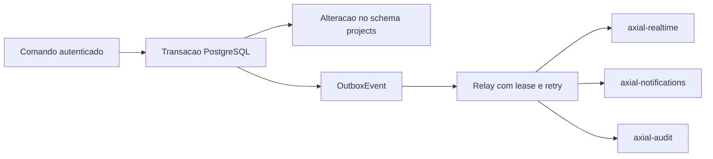

# Arquitetura

## Organização do monorepo

`apps/api` contém o serviço NestJS ms-projects, `apps/ms-identity` contém o serviço de identidade no schema próprio `identity`, `apps/ms-realtime` fornece invalidações por WebSocket, `apps/ms-notifications` processa notificações no schema próprio `notifications`, e `apps/web` contém o Workspace React/Vite. A pasta da API foi renomeada de apps/ms-projects para apps/api a pedido do usuário, preservando o pacote @axial/ms-projects e o schema projects. `packages/contracts` não depende de NestJS nem Prisma: compartilha validação Zod, tipos de autenticação, catálogo e envelope de eventos.

O frontend preserva a composição e o sistema visual do protótipo em componentes JSX. Seu repositório de demonstração é local, tipado, validado e isolado da persistência do protótipo. Não representa uma sessão autenticada da API e não aplica fallback de falhas HTTP. As incompatibilidades entre IDs fictícios, modelos visuais e contratos reais estão documentadas em frontend.md.

Controllers validam transporte e encaminham comandos; ProjectsService aplica regras; ProjectsRepository centraliza autorização de projetos, fronteira transacional, bloqueio do agregado e gravação do outbox. Acesso de persistência de cada operação usa o cliente transacional passado pelo repositório. Infraestrutura cuida de JWT, Prisma, Redis, configuração, saúde e ciclo de vida.

ESM usa imports relativos `.js`, TypeScript estrito e injeção explícita com `@Inject`, inclusive nos testes que não emitem metadata de decorators. Prisma gera cliente local no build, sem versionar o código gerado.

## Dados e concorrência

Tabelas próprias: Project, Epic, Task, TaskDependency, Sprint, Comment, Milestone e OutboxEvent, todas no schema `projects`.

Chaves estrangeiras compostas incluem organização e projeto nas relações relevantes. Índices atendem filtros de tarefas, responsáveis, sprints, projetos e relay. Migration SQL inclui constraints de datas/status/hierarquia e índice único parcial para sprint ativa.

Cada comando de agregado bloqueia a linha do projeto na transação, revalida acesso e estado e confere a versão do recurso. Isso serializa decisões que envolvem vários recursos, como ciclos, sequência de tarefas e início/encerramento de sprint. Projetos diferentes continuam independentes. É uma escolha conservadora para consistência; um projeto com muitas mutações simultâneas poderá exigir uma estratégia de bloqueio mais granular.

## Identidade externa

O ms-projects verifica JWT RS256 com chave pública configurada ou JWKS HTTPS. Emissor, audiência, subject, issued-at e expiração são obrigatórios. O ms-identity emite tokens com cinco minutos de validade e referências derivadas de seus próprios dados; associações de projetos são explícitas e não são validadas por consulta ao schema de projetos. Headers ou campos de corpo não podem trocar organização ou elevar acesso. As condições e limites do provisionamento estão em [ms-identity](../apps/ms-identity/README.md).

As claims de referências atribuíveis são um contrato inicial com a identidade, não uma consulta a tabelas externas. São um snapshot de autorização e podem ficar desatualizadas até o token expirar. O futuro ms-identity deverá emitir tokens curtos e claims corretas; revogação imediata/introspecção não está implementada neste serviço.

## Eventos

Alteração e evento confirmam juntos. O relay reivindica até 20 eventos com `FOR UPDATE SKIP LOCKED`, define lease de 60 segundos e incrementa tentativas. Só marca publishedAt após as três publicações confirmadas. Em falha, mantém o evento e agenda nova tentativa com backoff limitado a 15 minutos, sem descarte automático.

Cada fila usa event ID como job ID. Uma falha após publicar parcialmente é recuperável sem duplicar jobs ainda retidos. Eventos e jobs ficam preservados; operações de retenção devem ser definidas junto dos consumidores e nunca apagar dados ainda necessários para recuperação.

Não há garantia de exactly-once ou ordenação global. Consumidores devem deduplicar duravelmente por event ID e usar aggregate.version/occurredAt para tratar reordenação. Redis precisa de persistência e política noeviction. Perda total do Redis após publishedAt exige recuperação operacional dos eventos persistidos; publishedAt confirma enfileiramento, não consumo final.

## Evidências das convenções

Inspeção em 05/11/2026, sem alterar os repositórios de origem:

| Referência | Revisão | Convenção aproveitada |
| --- | --- | --- |
| suporte-app | 4c7c957953627145791a8882048d7f92111bcefe | apps/packages, pnpm/Turbo, catálogo, Nest ESM, Prisma, Zod, Biome, Vitest |
| finflow | 52c0dcbe728f9ed2c9485323410090e99545334f | pnpm 10.11.1, scripts raiz, Compose e workspace |
| omni-crm-ai | arquivos locais package.json e docs/architecture/repository-evidence.md | Fronteiras de organização, contratos, migrations e validação explícita |

Versões principais selecionadas e fixadas no lockfile: Nest 12.3.3, Prisma 7.10.1, Zod 4.6.7, BullMQ 5.81.5, Vitest 4.1.2, TypeScript 6.0.3. A release candidate do Prisma 8 não foi adotada.

Referências técnicas consultadas: [Prisma no NestJS](https://docs.nestjs.com/recipes/prisma), [OpenAPI no NestJS](https://docs.nestjs.com/openapi/introduction), [identificadores de jobs BullMQ](https://docs.bullmq.io/guide/jobs/job-ids).
